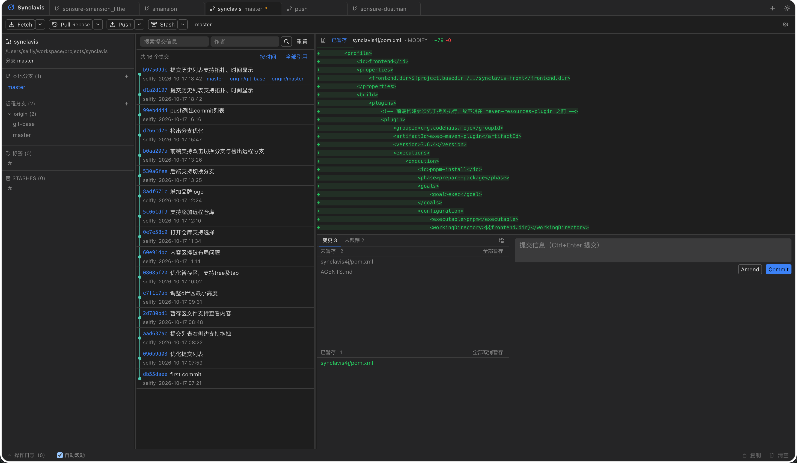

# Synclavis


> SourceGit 风格的 Web 版多仓库 Git 管理工具

Synclavis 是一个运行在浏览器中的 Git 仓库管理工具。界面参考桌面端 SourceGit 的布局、
信息密度与操作习惯：顶部 Tab 同时管理多个仓库，左侧栏浏览分支 / 标签 / Stash，
中间查看提交历史，右侧查看 Diff，底部完成暂存与提交。Git 操作由后端使用纯 Java 的
JGit 完成，**不依赖系统 `git` 命令**。



## ✨ 功能特性

- **多仓库 Tab**：同时打开多个仓库，Tab 显示当前分支、脏标记、ahead/behind 与冲突状态；支持中键关闭、拖拽排序、右键菜单。
- **快速操作**：Fetch / Pull / Push / Stash，各带下拉选项；远端操作通过 WebSocket 实时回传进度。
- **Pull 策略**：Merge / Rebase / FF-only 三种策略一等可选，按仓库独立记忆上次选择。
- **推送预览**：Push 前列出待推送提交与目标分支，无 upstream 时在同一弹窗内引导「设置并推送」。
- **分支管理**：侧栏双击切换本地分支、检出远程分支（自动建立跟踪关系）、新建分支并切换。
- **提交历史与 Diff**：提交图 / 列表（窗口化渲染）、搜索过滤、文件变更与结构化 Diff。
- **暂存与提交**：点击文件即可查看其具体改动（已暂存 / 未暂存 / 未跟踪各自对应正确比较基准），支持 Commit / Amend。
- **冲突与 Rebase 中间态**：高亮冲突文件，提供 Continue / Skip / Abort，并显示「Rebase in progress」状态条。
- **远程仓库管理**：新增 / 修改 URL / 删除 remote，新增后自动 Fetch 一次。
- **会话与布局持久化**：已打开仓库、激活 Tab、主题、面板尺寸由后端持久化，换浏览器不丢失。
- **深色 / 浅色主题**：深色优先，布局紧凑、桌面化。

## 🧱 技术栈

**前端**（`synclavis-front/`）

| 技术 | 版本 | 用途 |
|---|---|---|
| Vue | 3.4+ | 组合式 API，`<script setup lang="ts">` |
| TypeScript | 5.4+ | 严格模式 |
| Vite | 5 | 开发与构建 |
| Pinia | 2 | 状态管理 |
| Naive UI | 2.38+ | 基础组件 |
| Tailwind CSS | 3.4 | 样式与主题变量 |
| lucide-vue-next | — | 图标 |
| Vitest / Playwright | — | 单元测试 / E2E |

**后端**（`synclavis4j/`）

| 技术 | 版本 | 用途 |
|---|---|---|
| Java | **1.8** | 运行环境（锁定，不可升级） |
| Spring Boot | **2.7.18** | Web / WebSocket（2.x 最终版；3.x 需 JDK 17） |
| JGit | **5.13.0.202109080827-r** | 原生 Java Git 实现（5.x 最终版；6.x 需 JDK 11） |
| JGit SSH（Apache MINA SSHD） | 同上 | SSH 认证 |
| Maven | 3.5+ | 构建 |

> 版本锁定说明：JDK 8 环境下 Spring Boot 只能用 2.x、JGit 只能用 5.x，三者均不可升级。
> `mvn verify` 会通过 animal-sniffer 校验代码是否误用了 Java 9+ API。

## 📁 仓库结构

```
synclavis/
├── synclavis-front/   # Vue 3 前端（实装，只依赖 HTTP/WS 契约）
├── synclavis4j/       # Java 后端（实装，Spring Boot 2.7 + JGit 5.13）
├── synclavis4r/       # Rust 后端（占位，暂不实现，仅保留目录约定）
└── docs/              # 预览图等资源
```

后端关键分层：`repo/`（仓库与会话）、`git/`（fetch / pull / push / stash 等操作）、
`state/`（JSON 状态持久化）、`websocket/`（进度推送）、`auth/`（HTTPS / SSH 认证）、
`shared/`（统一响应与异常处理）。

## 🚀 快速开始

**前置要求**：JDK 8、Maven 3.5+、Node 18+、pnpm。

**1. 启动后端**

```bash
cd synclavis4j
mvn spring-boot:run
```

服务监听 `http://127.0.0.1:18080`（默认只绑定本机回环地址）。

**2. 启动前端**

```bash
cd synclavis-front
pnpm install
pnpm dev
```

浏览器打开 `http://127.0.0.1:5173`。开发服务器会把 `/api`、`/ws` 代理到后端。

**3. 打包成可执行 jar（可选）**

前端产物可直接打进后端 jar，构建完成后 `java -jar` 即可独立运行：

```bash
cd synclavis4j
mvn clean package -Pfrontend
java -jar target/synclavis4j-0.1.0-SNAPSHOT.jar
```

随后访问 `http://127.0.0.1:18080` 即是完整应用（前端与 API 同源）。
`frontend` profile 默认不激活，纯后端命令无需本机安装 Node / pnpm。

## ⚙️ 配置

| 变量 | 作用 | 默认值 |
|---|---|---|
| `SYNCLAVIS_HOME` | 后端状态目录（会话 / 设置） | `~/.synclavis` |
| `VITE_API_TARGET` | 前端 dev 代理的后端地址 | `http://127.0.0.1:18080` |

## 🧪 常用命令

前端（`synclavis-front/`）：

```bash
pnpm dev          # 开发
pnpm typecheck    # vue-tsc 类型检查
pnpm build        # 类型检查 + 构建
pnpm test:unit    # Vitest 单元测试
pnpm test:e2e     # Playwright E2E（需先启动后端）
```

后端（`synclavis4j/`）：

```bash
mvn -DskipTests compile         # 编译
mvn verify                      # 含 JDK 8 API 校验
mvn spring-boot:run             # 启动
mvn clean package -Pfrontend    # 整包：构建前端并打进 jar，java -jar 即可独立运行
```

## 📌 开发约束

- 后端锁定 JDK 8：禁用 `var`、`List.of`、`String.isBlank`、`Files.readString` 等 Java 9+ 语法与 API。
- 前端只使用通用名 `synclavis`，**禁止出现 `synclavis4j`**（保证后端可替换）。
- 前后端通过 HTTP / WebSocket 契约通信，契约变更需先定稿，再让所有后端（`synclavis4j`、`synclavis4r`）跟进。

## 📄 许可证

本项目采用 [GNU Affero General Public License v3.0（AGPL-3.0）](https://www.gnu.org/licenses/agpl-3.0.html) 许可。
